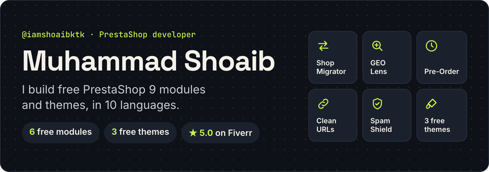

  

I'm Shoaib. I build PrestaShop modules and themes that are free, open source and translated into 10 languages: English, French, Spanish, Italian, Polish, German, Czech, Dutch, Portuguese and Russian. Each one is built for PrestaShop 9.

  
  
  

## Free PrestaShop 9 themes

Hummingbird child themes with a one-click demo in 10 languages and a live preview.

  
  
  

Live demos: [Little Sprout](https://iamshoaibktk.github.io/prestashop-theme-little-sprout/) · [Northline Outfitters](https://iamshoaibktk.github.io/prestashop-theme-northline-outfitters/) · [Maison Vellor](https://iamshoaibktk.github.io/prestashop-theme-maison-vellor/)

## Free PrestaShop 9 modules

Open source, with documentation and translations included.

  
  
  
  
  
  

Moving an old shop? Install [Shop Migrator Bridge](https://github.com/iamshoaibktk/prestashop-shopmigratorbridge) on it: a read-only connector for Shop Migrator.

## What I can build for you

- **Custom PrestaShop modules** for a feature your store needs.
- **Theme changes** or a new Hummingbird child theme.
- **Moving your store to PrestaShop 9** from 1.6, 1.7 or 8.

Message me on [Fiverr](https://www.fiverr.com/shoaibktk) or [WhatsApp](https://wa.me/923459016286). I reply quickly.

<b>Earlier PrestaShop modules</b>

- [PS Shield Guard](https://github.com/iamshoaibktk/psshieldguard): monitors traffic and blocks abusive IP activity.
- [Add Note PDF](https://github.com/iamshoaibktk/addnotepdf): adds a delivery note to invoice and delivery slip PDFs.
- [Add Voucher](https://github.com/iamshoaibktk/addvoucher): shows a voucher on products in listings.
- [Assign Customer Group](https://github.com/iamshoaibktk/assigncustomergroup): gives customers a second group.

